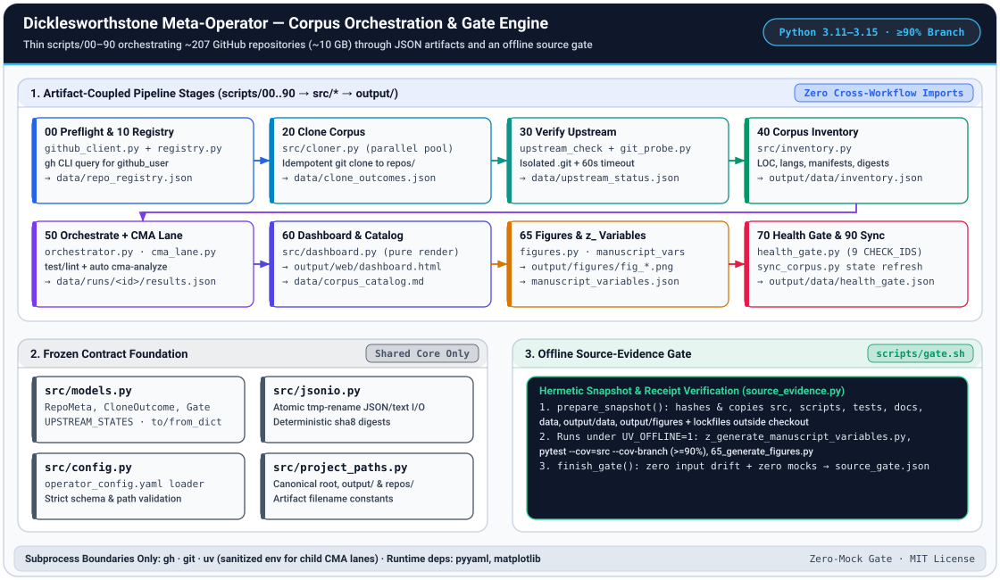

# Dicklesworthstone Meta-Operator documentation

The operator records repositories, summarizes their contents, and reports
whether local clones match their upstream default branches. The checked-in
registry, inventory, verification report, dashboard, and figures are
historical snapshots.



## Use the saved snapshot

From the standalone checkout, install the locked dependencies with
[uv](https://docs.astral.sh/uv/) and use Python 3.11 or later. Git is needed
for the offline source test fixtures. A GitHub login, a corpus checkout,
and the external CMA project are unnecessary for rendering saved results.

```sh
uv sync --locked
uv run --locked python scripts/60_dashboard.py
uv run --locked python scripts/65_generate_figures.py
```

Open `output/web/dashboard.html` in a browser. The companion catalog is
`output/data/corpus_catalog.md`. These commands rewrite generated files in
the checkout using saved inputs. Use a disposable checkout for comparison
with the retained artifacts. A regenerated dashboard is still a view of the
saved registry and verification data.

| Topic | Guide |
| --- | --- |
| Setup and configuration | [Standalone checkout](standalone.md) and [runtime input](reference/data.md) |
| Stages and artifacts | [Pipeline reference](reference/scripts.md) and [artifact contracts](architecture.md) |
| Research | [Manuscript sources and render commands](manuscript/README.md) |
| Verification | [Offline source gate and evidence scope](evidence.md) and [test suite](reference/tests.md) |
| Development | [Contributor guidance](agent_instructions.md), [module reference](reference/source.md), and [testing philosophy](testing_philosophy.md) |
| Task records | [Task index and historical notes](task-index.md) |
